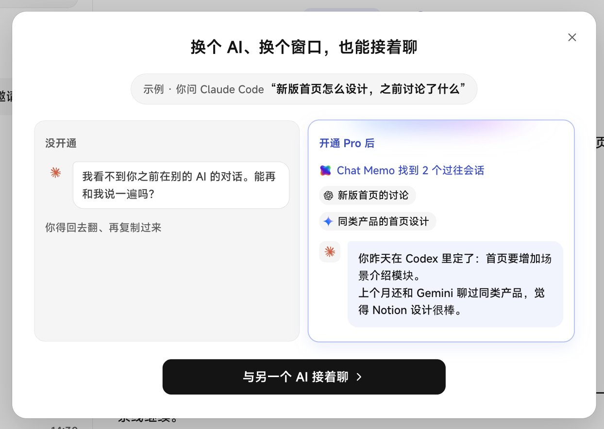
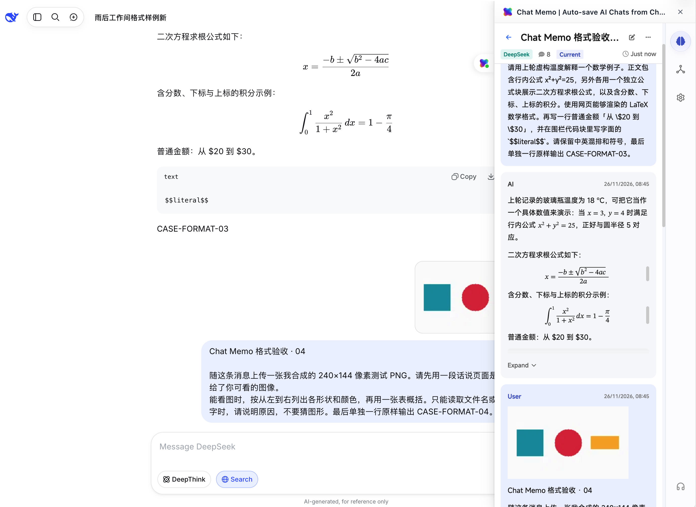
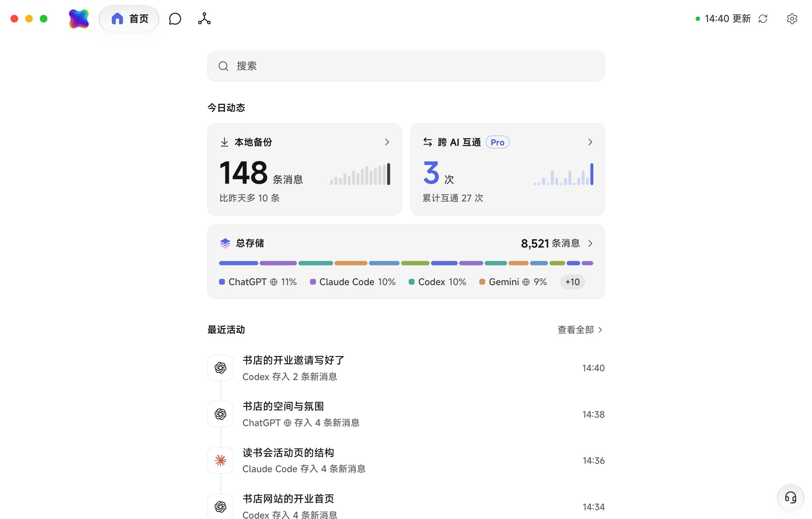
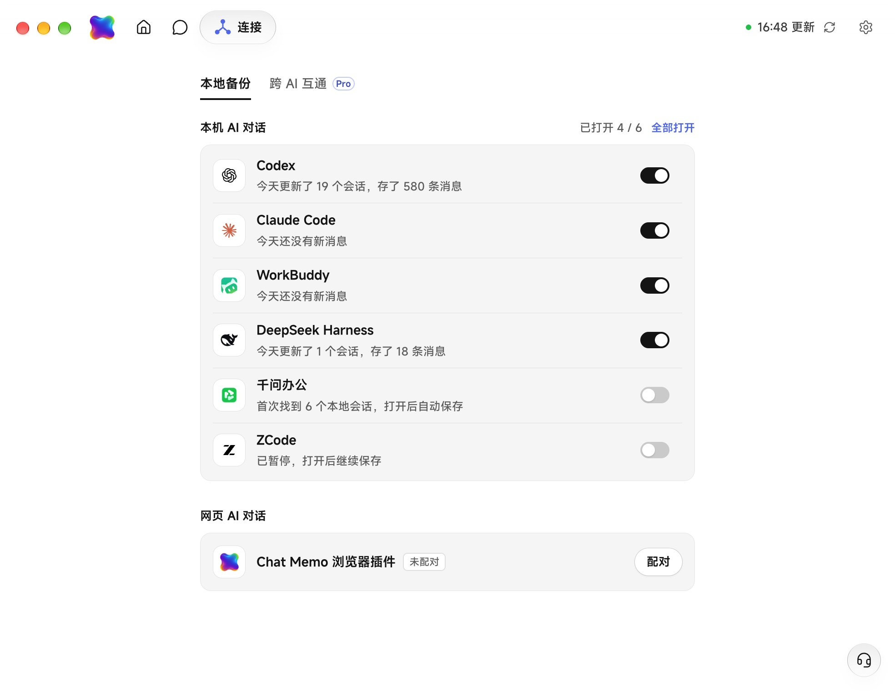

# Chat Memo

把网页和电脑上的 AI 对话保存在自己的设备上。换一个 AI 聊天时，你可以授权它找回之前讨论过的内容。这个仓库提供 Chat Memo 产品介绍、下载入口和浏览器插件隐私政策。

[官网](https://chatmemo.ai/zh-CN/) · [下载桌面端和浏览器插件](https://chatmemo.ai/zh-CN/downloads) · [更新日志](https://chatmemo.ai/zh-CN/updates) · [界面预览](#界面预览) · [English](#english)

## 界面预览

**换到 Claude Code，继续上次的讨论 · Continue a conversation across AI tools**

桌面端的 Pro 功能用一个首页设计问题举例：在 Claude Code 里问“之前讨论了什么”，它可以通过 Chat Memo 找回先前在 Codex 定下的改动，以及在 Gemini 聊过的设计参考。

**把网页对话里的公式和图片一起存下来 · Save formulas and images from web chats**

左边是 DeepSeek 原对话，右边是插件保存的副本。对照两边可以看到，求根公式的分数、根号和积分的上下限都保留下来，消息里上传的图片也能在侧栏查看。

查看桌面端的备份概览和来源设置 · Backup activity and sources

首页把各个 AI 的最近活动排在一起，可以看到哪些对话刚刚有了新消息。

在「连接」里可以逐个选择要备份的本机 AI 工具，也可以配对浏览器插件，把网页对话同步到桌面端。

## 我可以保存哪些对话？

- **浏览器插件**会在你使用 ChatGPT、Gemini、Claude、DeepSeek、豆包、Kimi、通义千问和腾讯元宝的网页版时保存对话。你可以在浏览器里搜索、阅读和导出记录。需要补齐旧消息时，打开原对话，缓慢向上滚动，让历史内容逐段加载。
- **桌面端**可以备份 Codex、Claude Code、WorkBuddy 等工具在电脑上产生的对话。把插件与同一台电脑上的桌面端配对后，网页对话也能同步到桌面端。对于支持导入的平台，还可以用平台导出的数据包补齐历史。

## 其他 AI Agent 可以调用我的记忆吗？

可以。通过 Chat Memo Pro，在桌面端按指引连接支持 MCP（Model Context Protocol）的 AI 客户端并授权。之后，你可以问它“我之前为什么选了这个方案？”，让它从已保存的会话中找出相关片段，再接着讨论。把插件与桌面端配对，只完成网页对话同步；你可以单独决定把记忆开放给哪个 AI。

[Pro 功能](https://chatmemo.ai/zh-CN/pricing) · [浏览器插件隐私政策](PRIVACY_POLICY.md) · [桌面端与 AI 互通隐私政策](https://chatmemo.ai/zh-CN/desktop/privacy) · [反馈](https://chatmemo.ai/feedback)

## English

Chat Memo saves AI conversations on your device. When you switch to another assistant, you can give it access to earlier conversations so it can pick up where you left off.

- **The browser extension** saves web chats from ChatGPT, Gemini, Claude, DeepSeek, Doubao, Kimi, Qwen, and Tencent Yuanbao. You can search, read, and export them in your browser. To capture older messages, open the original chat and scroll up slowly as the page loads them.
- **Chat Memo Desktop** backs up conversations from tools such as Codex, Claude Code, and WorkBuddy. Pair the extension with Desktop on the same computer to include your web chats. You can also import chat archives exported by supported platforms.
- **Other AI agents can retrieve memories with your permission.** With Chat Memo Pro, follow the steps in Desktop to connect and authorize an MCP-compatible AI client. You can then ask it to find relevant excerpts from past conversations. You choose which clients get access separately from pairing the browser extension.

[Product previews](#界面预览) · [Website](https://chatmemo.ai/en/) · [Download Desktop or the extension](https://chatmemo.ai/en/downloads) · [Release notes](https://chatmemo.ai/en/updates) · [Pro features](https://chatmemo.ai/en/pricing) · [Extension privacy policy](PRIVACY_POLICY.md) · [Desktop and AI integrations privacy policy](https://chatmemo.ai/en/desktop/privacy)

Maintained by [Eze](https://github.com/eze-is).
