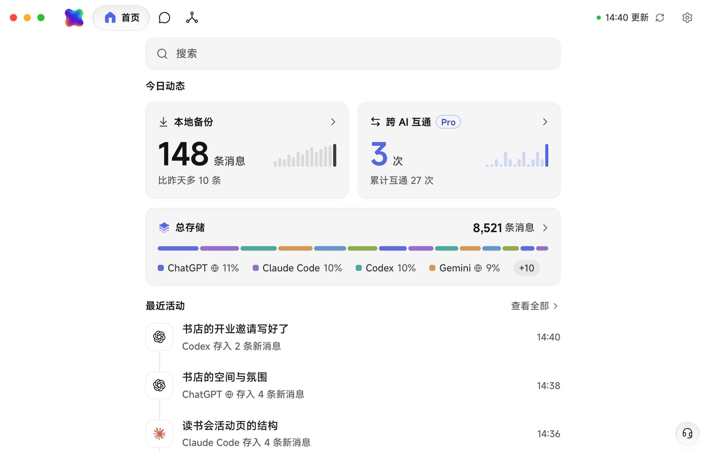
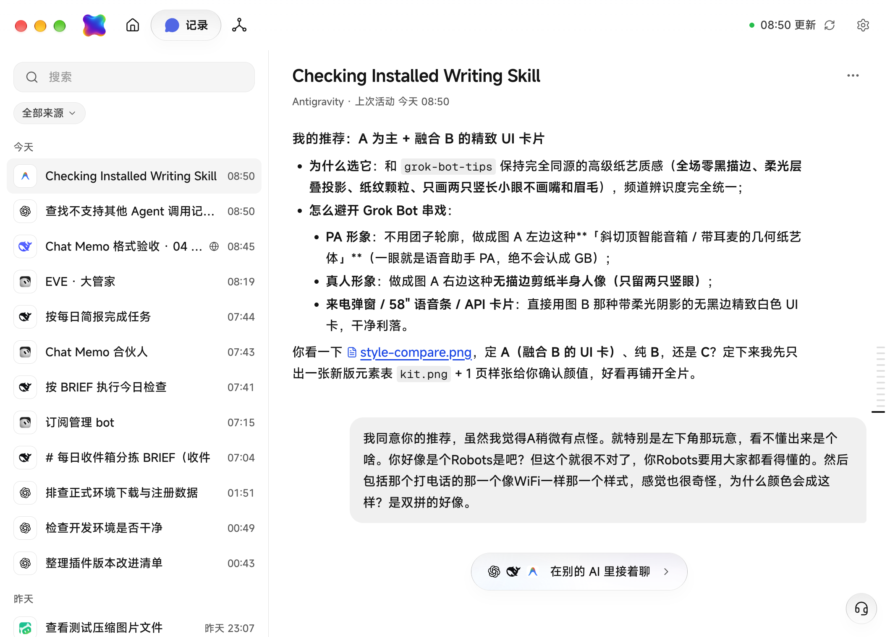
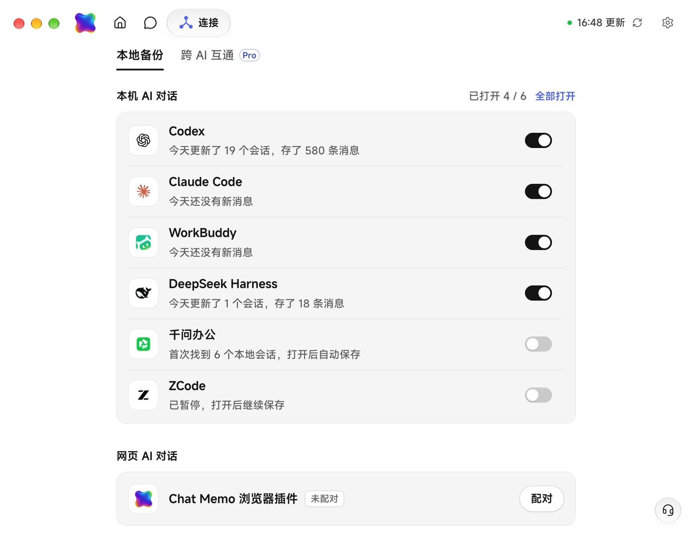

# Chat Memo

Chat Memo 是世界上最易用的跨 AI 上下文记忆中枢，也是保存格式最无损的对话备份、导出工具。 
它能将你在 ChatGPT、Claude、DeepSeek 等平台的零散对话，实时存为私密、可随时检索的个人记忆资产，不再遗失。也能随时把网页或本地 Agent 聊到一半的话题，换个 AI 也能随时续聊。

[官网](https://chatmemo.ai/zh-CN/) · [下载桌面端和浏览器插件](https://chatmemo.ai/zh-CN/downloads) · [更新日志](https://chatmemo.ai/zh-CN/updates) · [界面预览](#界面预览) · [English](#english)

## 界面预览

**桌面端 · Desktop**

**浏览器插件 · Browser extension**

## 我可以保存哪些对话？

- **浏览器插件**会在你使用 ChatGPT、Gemini、Claude、DeepSeek、豆包、Kimi、通义千问和腾讯元宝的网页版时保存对话。你可以在浏览器里搜索、阅读和导出记录。需要补齐旧消息时，打开原对话，缓慢向上滚动，让历史内容逐段加载。
- **桌面端**可以备份 Codex、Claude Code、WorkBuddy 等工具在电脑上产生的对话。把插件与同一台电脑上的桌面端配对后，网页对话也能同步到桌面端。对于支持导入的平台，还可以用平台导出的数据包补齐历史。

## 其他 AI Agent 可以调用我的记忆吗？

可以。在 Chat Memo 桌面端按指引连接支持 MCP（Model Context Protocol）的 AI 客户端并授权。之后，你可以问它“我之前为什么选了这个方案？”，让它从已保存的会话中找出相关片段，再接着讨论。把插件与桌面端配对，只完成网页对话同步；你可以单独决定把记忆开放给哪个 AI。

[浏览器插件隐私政策](PRIVACY_POLICY.md) · [桌面端与 AI 互通隐私政策](https://chatmemo.ai/zh-CN/desktop/privacy) · [反馈](https://chatmemo.ai/feedback)

## English

Chat Memo saves AI conversations on your device. When you switch to another assistant, you can give it access to earlier conversations so it can pick up where you left off.

- **The browser extension** saves web chats from ChatGPT, Gemini, Claude, DeepSeek, Doubao, Kimi, Qwen, and Tencent Yuanbao. You can search, read, and export them in your browser. To capture older messages, open the original chat and scroll up slowly as the page loads them.
- **Chat Memo Desktop** backs up conversations from tools such as Codex, Claude Code, and WorkBuddy. Pair the extension with Desktop on the same computer to include your web chats. You can also import chat archives exported by supported platforms.
- **Other AI agents can retrieve memories with your permission.** Follow the steps in Chat Memo Desktop to connect and authorize an MCP-compatible AI client. You can then ask it to find relevant excerpts from past conversations. You choose which clients get access separately from pairing the browser extension.

[Product previews](#界面预览) · [Website](https://chatmemo.ai/en/) · [Download Desktop or the extension](https://chatmemo.ai/en/downloads) · [Release notes](https://chatmemo.ai/en/updates) · [Extension privacy policy](PRIVACY_POLICY.md) · [Desktop and AI integrations privacy policy](https://chatmemo.ai/en/desktop/privacy)

Maintained by [Eze](https://github.com/eze-is).
